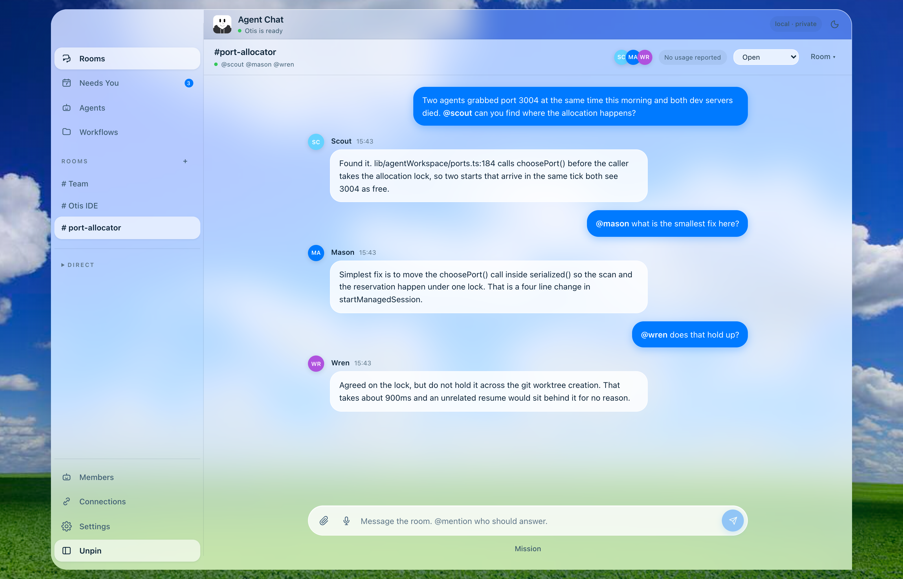
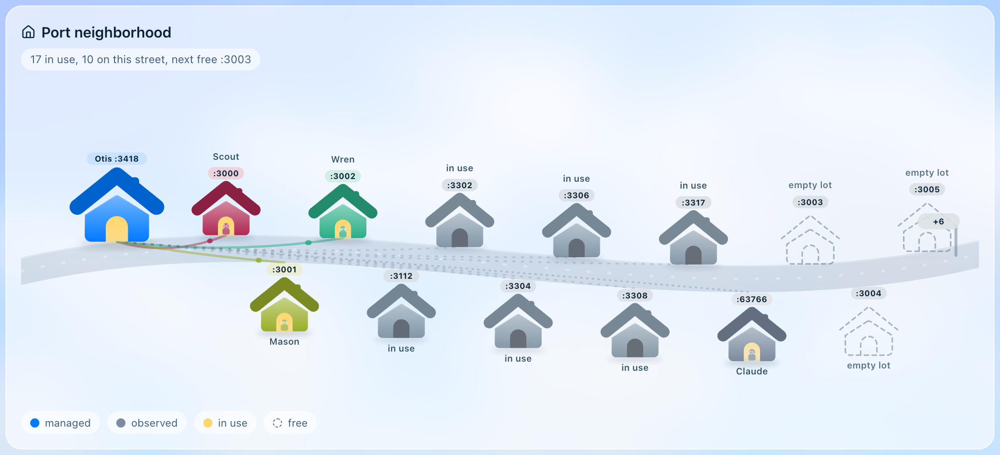
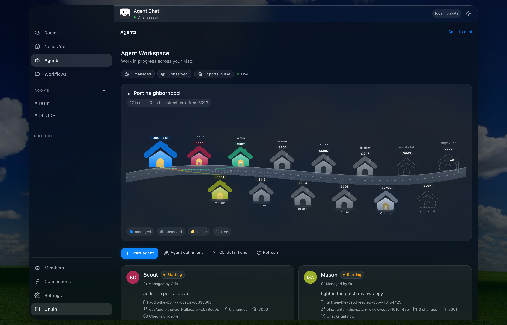

# Otis IDE

**Run a fleet of Claude Code and Codex agents on your Mac, in parallel, without them stepping on each other.**

Free. Uses the Claude Code and Codex CLIs you already have logged in, so there are no API keys to buy and no per-token cost on top of your own subscriptions.

[**Download the latest .dmg**](https://github.com/reh8n/otis-ide-releases/releases/latest) · [Report a bug](https://github.com/reh8n/otis-ide-releases/issues/new) · [Discussions](https://github.com/reh8n/otis-ide-releases/discussions)



## Why

Running more than one coding agent at once usually means a pile of terminals, two agents editing the same files, dev servers fighting over port 3000, and a question you missed three tabs ago. Otis IDE gives every agent its own lane and gives you one place to watch all of them.

- **Isolated sessions.** Each agent gets its own git worktree, its own `otis/` branch and its own port. Ten agents can run at once without collisions, and your real checkout is never touched.
- **Rooms.** Put several agents in one room, @mention who should answer, and give each seat its own permissions (read, write, run).
- **Needs You inbox.** Every agent blocked on a human (a question, an approval, a patch to review, a failed check) lands in one queue.
- **Hunk-by-hunk review.** Accept some changes, reject others. A checkpoint is taken before anything applies.
- **Coding Mode (⌘⇧E).** Code on the left, the room on the right, and a small 3D office above it showing who is thinking, writing, running a tool or waiting on you.
- **Workflows.** Templates for planning a feature, fixing a bug, investigating failing tests, reviewing a change, refactoring and release readiness.



## Requirements

- macOS on Apple Silicon
- At least one of the [Claude Code](https://docs.anthropic.com/en/docs/claude-code) CLI or the Codex CLI, installed and logged in (the app can install a missing CLI for you)

## Install

1. Download the `.dmg` from [Releases](https://github.com/reh8n/otis-ide-releases/releases/latest) and drag Otis IDE to Applications.
2. Current builds are not yet notarized, so the first launch is blocked by Gatekeeper. Right-click the app and choose **Open**, or run:

   ```bash
   xattr -dr com.apple.quarantine "/Applications/Otis IDE.app"
   ```

3. Open it. The app updates itself from this page after that.



## Privacy

Everything stays on your Mac. No account, no sync, no telemetry. The app never stores an observed process's command line, since that can carry a private prompt.

## Feedback

This is early and moving fast. Bugs go in [Issues](https://github.com/reh8n/otis-ide-releases/issues). Ideas, questions and "here is how I use it" go in [Discussions](https://github.com/reh8n/otis-ide-releases/discussions). If it saves you time, a star helps other people find it.

---

<sub>This repository hosts release binaries only. Each release carries the arm64 `.zip` the in-app updater installs, the `.dmg` for a manual install, and a `latest.json` holding the zip's SHA-256.</sub>
